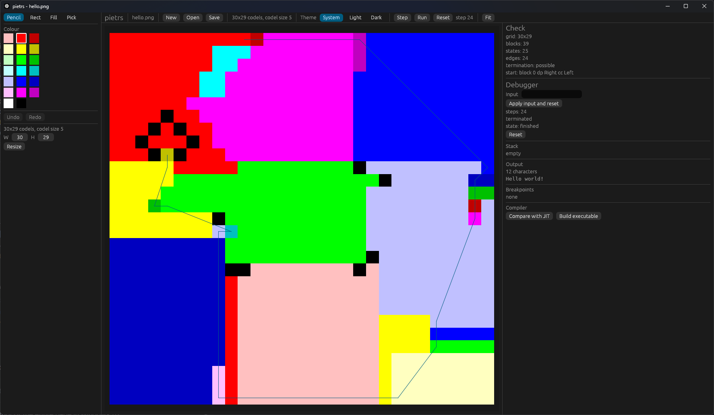

# pietrs

Compiles the tessellation flow of a given canvas.

`pietrs` compiles a [Piet](https://www.dangermouse.net/esoteric/piet.html)
program — an image — into a standalone native executable. The program's control
flow is resolved at compile time into a finite state graph, Cranelift lowers that
graph, and `pietrs build` writes the executable itself: no C compiler, no linker,
and no `rustc` runs on the machine that builds a program.

```
program.png ─> codel grid ─> colour blocks ─> (block, DP, CC) graph
                                              ├─> interpreter    (trace, oracle)
                                              ├─> Cranelift JIT  (`run`)
                                              └─> object + runner (`build`)
```

Piet's two-dimensional geometry looks like the hard part of the language. It is
not: for a given image, the movement rules resolve into a finite graph over
`(colour block, direction pointer, codel chooser)`, one unconditional edge per
state. Only `pointer` and `switch` read the stack, and each lowers to a jump
table over two or four statically known successors — exactly the shape a
compiler backend expects.

> **Try it in the browser:** [sdgoij.github.io/pietrs](https://sdgoij.github.io/pietrs) —
> the same editor and debugger, compiled to WebAssembly.

## Install

Download the archive for your platform from the
[releases](https://github.com/sdgoij/pietrs/releases) page, unpack it, and put
`pietrs` somewhere on your `PATH`. The archives hold the binary, this README, and
the licence.

Or build from source (Rust 1.98, pinned in `rust-toolchain.toml`):

```sh
cargo build --release
target/release/pietrs --help
```

## Use

```sh
# What did the image decode into? Grid, blocks, state graph, and whether the
# program can ever terminate.
pietrs check program.png

# Run it: the JIT, in process. Without --input it reads standard input, so an
# interactive program waits for a line.
pietrs run program.png

# Same, with a file of input (read before standard input) and a step bound.
pietrs run adder.png --input numbers.txt --max-steps 100000

# One line per transition, for debugging or diffing.
pietrs trace program.png --max-steps 200

# Compile it to a standalone executable.
pietrs build program.png -o program
./program

# The executable takes the input file `run` takes, read before standard input.
./program records.txt

# A run is unbounded unless you bound it: `--max-steps N` stops after N
# transitions, and replaces whatever `build` baked in.
./program records.txt --max-steps 100000

# Open the visual editor and debugger.
pietrs editor program.png
```

`pietrs build` writes the whole executable: the program, plus a runner that is
compiled into `pietrs` itself and embedded at build time. Nothing is linked when
you build a program, which is why a cross build needs no target toolchain.

### Commands

| Command | What it does |
|---|---|
| `editor` | opens the visual editor and debugger; compiled in by default, absent from a `--no-default-features` build |
| `check` | decodes, partitions, and builds the state graph without executing; reports whether any reachable state terminates |
| `trace` | runs the reference interpreter and prints every transition |
| `run` | runs the program through the JIT and prints its output |
| `build` | writes a standalone executable for the host or `--target` |
| `selftest` | runs a corpus through every execution path and compares them |

### Editor

`pietrs editor` opens a PNG or GIF and paints on the twenty-colour palette with
pencil, rectangle, fill, and eyedropper; undo, redo, and the window title's
dirty marker are there. The debugger steps with F10, runs and pauses with F5,
sets block breakpoints, and shows the stack and the output. The Compiler panel
compares the interpreter with the JIT and builds a standalone executable. The
image is the document: Save writes it back as a PNG at its codel size. The
theme choice persists across launches.



### In the browser

A build of `main` is published at
[sdgoij.github.io/pietrs](https://sdgoij.github.io/pietrs).

The same editor compiles to WebAssembly. Building the bundle needs
`wasm-bindgen-cli` at the version `Cargo.lock` pins; `xtask` checks it first and
names the mismatch if it is wrong:

```sh
cargo run -p xtask -- wasm        # writes target/web
python -m http.server -d target/web 8000
```

`target/web` is a static bundle — `index.html`, `pietrs.css`, `pietrs.js`, and
`pietrs_bg.wasm` — that any file server can host. The editor opens with the
canonical "Hello world!" program already loaded, and the footer links back here
and to the [Piet specification](https://www.dangermouse.net/esoteric/piet.html).
Opening and saving go through the browser's file picker, so a document's identity
is its file name and Save is a download. The JIT comparison and `build` are absent
there: `cranelift-jit` cannot target wasm, and a wasm module cannot write an
executable. Everything else — painting, undo, stepping, breakpoints, the stack,
the output, the trail, the theme — is the desktop editor's code.

### A Piet interpreter in Piet

`pietrs` ships the language's reference interpreter as a Rust crate. It also
*generates* one as an image: `loom` weaves a Piet program that reads another
Piet program from its input and runs it. It interprets the language's
straight-line fragment — the fifteen commands that leave the direction pointer
alone — and the image is laid out by search rather than drawn, because a
command is a colour transition and a layout is a colour walk. The canonical
*Hello world!* program is straight-line, so the generated interpreter runs it:

```sh
cargo run -p loom --example weave -- target/weave crates/gui/web/hello.png
target/debug/pietrs run target/weave/interpreter.png --input target/weave/program.txt
```

The front end is generated too: a P3 PPM goes in, and the grid's colour codes
come out, so a picture written as text needs no decoder on the host side.

```sh
cargo run -p loom --example ppm -- target/weave/ppm.png
target/debug/pietrs run target/weave/ppm.png < program.ppm

# The whole frontend, from the picture to the program's output: the image
# decodes the PPM, the image resolves the moves, the walker runs it.
cargo run -p loom --example run-ppm -- program.ppm "10 3"
```

See [`crates/loom/fixtures/hello-world/`](crates/loom/fixtures/hello-world/)
and [`.agents/notes/piet-in-piet.md`](.agents/notes/piet-in-piet.md). A program
that is not linear is refused before it runs, naming the block that branches.

### Images

PNG and GIF (the first frame) are decoded, at any codel size: the size is
detected from the image, and `--codel-size N` overrides it. A colour outside the
twenty is reported on stderr and treated as white, as the specification suggests —
an image whose palette has been mangled otherwise looks like a program that loops.

### Cross-compiling

```sh
pietrs build program.png -o program.exe --target x86_64-unknown-linux-gnu
```

The embedded runners cover the host and, on every host, `x86_64-unknown-linux-*`
and `aarch64-unknown-linux-*` (the GNU triples run the static musl artefacts
unchanged). Adding a target means adding a runner and an ISA to the compiler, not
a toolchain to the user's machine.

### Bounds and diagnostics

- `--max-steps N` stops a run and reports the limit; without it an unbounded
  program runs for ever, and `check` tells you in advance when that is true.
- `PIETRS_DUMP_GRAPH=1` writes the state graph to stderr; `PIETRS_DUMP_CLIF=1`
  writes the lowered function; `PIETRS_JIT_DISASM=1` writes the machine code.

## Semantics

The target is the clarified 2018 Piet specification, with npiet v1.3h as the
conformance oracle. Integers are `i64`; division and modulo are floored by
default (`--division truncating` selects npiet's rounding); I/O is Unicode
codepoints over UTF-8; the value stack has a fixed capacity and reports overflow.
Every place where `pietrs` observably differs from npiet is recorded in
[`.agents/notes/divergences.md`](.agents/notes/divergences.md), and `pietrs
selftest` checks the interpreter, the JIT, and a packaged executable against each
other on the corpus.

## Development

```sh
just gate   # fmt, clippy, tests, long tests, feature shapes, doc, licences
just perf   # the ignored performance harnesses
just fuzz png 100000   # one fuzz target, needs cargo-fuzz and nightly
```

The working agreement — test layers, verification gates, and the invariants a
change must not break — is [`AGENTS.md`](AGENTS.md). Design notes live in
[`.agents/notes/`](.agents/notes/).

| Crate | Role |
|---|---|
| `canvas` | image → codel grid → 4-connected colour blocks |
| `tessera` | movement, white slides, and the `(block, DP, CC)` state graph |
| `runtime` | stack, I/O, floored arithmetic |
| `interp` | the reference interpreter: trace, oracle, no codegen |
| `loom` | generates a Piet program that interprets linear Piet programs |
| `editor` | the document, undo, analysis cache, and debug session; no UI |
| `gui` | the egui editor and debugger; `pietrs editor`, and the wasm bundle |
| `codegen` | Cranelift lowering; JIT and object emission |
| `aot` | packages an object plus an embedded runner into an executable |
| `runner` | the embedded runner: maps the payload and calls `piet_main` |
| `cli` | the `pietrs` binary |
| `testkit`, `xtask`, `perf` | fixtures, developer gates, ignored harnesses |

## Licence

GPL-2.0-only. See [`LICENSE.md`](LICENSE.md).
